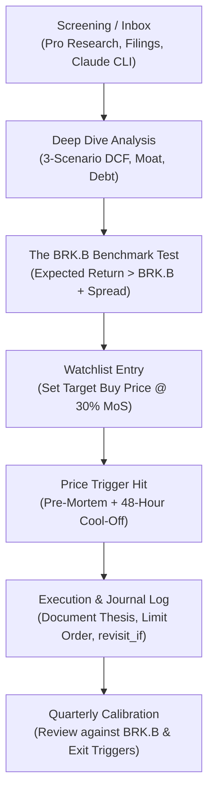

# Investment Policy Statement (IPS)

**Version:** 0.4 (draft)  
**Date:** 2026-11-05  
**Status:** Translated to English. **BRK.B established as the baseline benchmark ("The Index to Beat")**; principles in sections 1–3 established; parameters marked with **[DECIDE]** require final calibration.

---

## 1. Philosophy & Objective

- **Core Strategy:** Buy wonderful businesses when their price is temporarily depressed (margin of safety), with conservative balance sheets (no debt/refinancing risk), exceptional capital-allocating management, and clear growth runways.
- **Moat Requirement:** Every business must possess a durable, identifiable economic moat (regulatory barriers, high switching costs, network effects, cost advantages, or scale).
- **Capital Turnover:** Sell when the thesis has played out or intrinsic value is realized, and redeploy capital into the next qualified opportunity (or back into the baseline asset).
- **Long-term Goal:** Build a systematic, disciplined investing process capable of serving as a primary vocation and full-time capital allocation career.
- **The Baseline Benchmark:** **Berkshire Hathaway Class B (BRK.B)** is my official baseline benchmark and the hurdle to beat. The fundamental test of my active investing is: **Can I beat BRK.B over a 5-year cycle, net of taxes, transaction friction, and single-stock risk?**

---

## 2. Mandatory Entry Criteria (All 7 Required)

No position is initiated unless every single criterion is met:

1. **Identifiable Economic Moat:**  
   I must clearly identify the primary moat source (regulatory license, switching costs, network effect, cost leadership, distribution scale) and answer: *How difficult and costly is it for a customer to switch to a competitor?*
2. **Temporary, Fixable Drawdown:**  
   There must be an explicit, documented reason for the price decline. I must verify that only the market price is depressed, not the underlying long-term unit economics (e.g., cyclical motor underwriting in Admiral). Serial guidance downgrades or structural disruption (e.g., Fiserv) disqualify a candidate as "not temporary."
3. **No Debt or Solvency Risk:**  
   - *Non-financials:* Net cash or Net Debt / EBITDA ≤ ~2.0x, with no major refinancing walls within the next 24–36 months.  
   - *Financials (insurers, lenders, payment processors):* Assess capital adequacy directly (solvency ratio, CET1, reserve quality and redundancy, liquidity) rather than debt ratios.
4. **Owner-Oriented Management & Capital Allocation:**  
   Proven track record of disciplined capital allocation (accretive reinvestment, counter-cyclical share repurchases, prudent dividends). Meaningful insider alignment/ownership. Zero executive turmoil (no revolving CEO/CFO doors or retracted multi-year guidance).
5. **Clear Value Realization Driver:**  
   A concrete operational or financial catalyst to restore intrinsic value: either compounding earnings growth, margin normalization, or multiple re-rating as temporary fears subside.
6. **Margin of Safety ≥ 30% to Weighted Intrinsic Value:**  
   The market price must trade at a ≥ 30% discount to my 3-scenario weighted Intrinsic Value (IV).
7. **Mandatory Pre-Action Checklist:**  
   - One-sentence thesis recorded in the journal.
   - Independent 3-scenario DCF/IV calculated by me (not external analysts).
   - Adversarial pre-mortem ("Why this will fail").
   - Explicit exit triggers (`revisit_if`).
   - Strict 48-hour cool-off rule between finishing research and placing an order.
   - **The BRK.B Benchmark Test:** Demonstrable expected return spread over holding BRK.B.

---

## 3. Valuation Framework

- **Three-Scenario Intrinsic Value (IV):**  
  Every asset is valued across Bear (25%), Base (50%), and Bull (25%) scenarios.
- **Discount / Hurdle Rate:**  
  Baseline discount rate of 9.0%, with sensitivity tested between 8.0% and 11.0%.
- **Reverse DCF:**  
  Always perform a reverse DCF: *"What growth rate, margins, and terminal multiple are implied by the current market price?"*
- **Cyclical Companies:**  
  Value on mid-cycle, normalized earnings rather than peak-year windfalls.
- **Financial Companies:**  
  Value on Free Cash Flow to Equity (FCFE) with realistic regulatory capital retention and sustainable payout assumptions.
- **Earnings Quality Audit:**  
  GAAP vs. Adjusted EPS reconciliation, scrutiny of recurring "non-recurring" charges, SBC dilution, and net interest income contribution to FCF.
- **Buy Limit (Margin of Safety Target):**  
  `Target Buy Price ≤ 0.70 × Weighted IV`

---

## 4. Opportunity Cost & Baseline Benchmark: BRK.B as the Hurdle

Active stock picking is only rational if it beats the return of a passive or semi-passive alternative. Instead of using the S&P 500 or risk-free cash, **BRK.B is my designated baseline index and hurdle rate**.

### Why BRK.B is the Baseline
1. **Quality & Resilience:** Holding BRK.B offers a diversified collection of recession-tested businesses, premier insurance float, unmatched balance sheet strength, and enormous cash optionality deployed counter-cyclically.
2. **Tax Efficiency:** Berkshire pays no dividend and retains earnings without taxable distributions, compound-growing book value with zero annual tax drag until realization.
3. **The Active Hurdle:** Reallocating capital away from BRK.B into an individual stock introduces idiosyncratic single-stock risk, research overhead, and capital gains tax drag. Therefore, any candidate must clear a hurdle premium above BRK.B.

### The Hurdle Formula
To justify buying a candidate stock, its expected annualized return over a 3–5 year horizon must satisfy:

$$\text{Candidate Expected Annual Return} \ge \max\Big(9.0\%,\; \text{BRK.B Implied Return} + \Delta_{\text{hurdle}}\Big)$$

- **$\Delta_{\text{hurdle}}$ (The Reallocation Spread):** **[DECIDE: propose +3.0 to 4.0 percentage points]** after taxes.  
  - Covers the tax drag of realizing gains in BRK.B (~0.4–0.5 p.p./yr over 5 years under 19% Polish Belka tax).
  - Compensates for non-diversified execution and business risks in a single stock.

### Current Baseline Metrics (as of November 2026)
- **BRK.B Market Price:** ~$574.50 (Base DCF: $508–$510, Bull DCF: $559).
- **BRK.B Base Implied Annual Return:** $\approx 7.6\%$ at $574.50 ($\approx 8.2\%$ at $542.50$).
- **After-tax Cash (T-bills / High Yield):** $\approx 2.8\%$ net of 19% tax.
- **Conclusion:** Holding BRK.B still vastly outperforms cash ($\approx +4.8\text{ p.p.}/\text{year}$), but trades slightly above base IV. Any candidate taking its place must credibly offer $\ge 11.0\%\text{–}12.0\%$ annualized return after tax.

---

## 5. Portfolio Construction & Position Sizing

| Parameter | Current State | Policy Target |
|---|---|---|
| **Baseline Anchor (BRK.B)** | $\approx 90\text{–}93\%$ | Default capital anchor; trimmed only for qualified candidates |
| **Max Single Active Position** | — | **[DECIDE: 20% – 30%]** of total portfolio |
| **Active Satellite Positions** | Minimal | **[DECIDE: 3 – 6]** high-conviction ideas |
| **Emergency Cash Reserve (Outside Portfolio)** | $50,000 | 6 months of living expenses (untouchable buffer) |

### Principles of Allocation:
- **No Idle Cash Drag:** Capital that does not have an active, high-conviction home trading at $\ge 30\%$ margin of safety resides in the baseline anchor (BRK.B), not cash.
- **Concentration with Protection:** Active bets must be concentrated enough to move the needle (minimum 3–5% initial allocation, max 20–30%), but structured so that a total loss on any single idea cannot impair long-term compounding.
- **Firewall:** Living expenses are fully separated in an external emergency buffer so that portfolio assets are never sold under distress.

---

## 6. Sell & Reallocation Disciplines

A position is sold or trimmed only when one of the following explicit conditions occurs:

1. **Thesis Realized (Valuation Reached):**  
   The price reaches or exceeds Base Intrinsic Value, and the forward implied return drops below the baseline hurdle. Clarify what drove the realization (operational earnings growth vs. multiple expansion).
2. **Thesis Broken (Fundamental Impairment):**  
   Serial guidance cuts, permanent moat erosion, loss of competitive edge, accounting red flags, management misconduct, or unhedged balance sheet distress. Mandatory re-underwriting within 7 days. If a pre-mortem scenario materializes $\rightarrow$ liquidate immediately.
3. **Superior Opportunity (The Hurdle Reallocation):**  
   A new candidate clears all 7 entry criteria and offers an expected return exceeding the current holding by $\ge \Delta_{\text{hurdle}}$ net of capital gains tax.
4. **Time Stop (24-Month Review):**  
   If after 24 months a special-situation investment has failed to progress toward intrinsic value, reset and re-underwrite from scratch. Sunk time is not forward information.
5. **Tax & Friction Check:**  
   Calculate the net tax impact (e.g., 19% Polish capital gains tax vs. potential future Cyprus non-dom 0% tax) before executing any sale. Never sell a compounder at fair value simply to sit in cash.

---

### 6.1 Valuation Action Matrix

*Note: IV refers to weighted Intrinsic Value ($0.25\,\text{Bear} + 0.50\,\text{Base} + 0.25\,\text{Bull}$ calculated at a 9% hurdle rate).*

| Price relative to IV | Action |
|---|---|
| **$\le 70\%$** (Margin of Safety $\ge 30\%$) | **Strong Buy / Add** (if full checklist passes) |
| **$70\% \text{ to } 95\%$** | **Hold / Accumulate selectively** |
| **$95\% \text{ to } 110\%$** (Fair Value) | **Hold** if implied return $\ge$ baseline benchmark and no superior candidate exists |
| **$> 110\%$ up to Bull IV** | **Trim in tranches** into qualified candidates |
| **$>$ Bull IV or Thesis Broken** | **Exit completely** |

---

### 6.2 Two Thesis Archetypes

Every idea in the journal must be classified into one of two categories:

1. **"Temporary Fear / Special Situation"** *(e.g., Admiral 2023, Kaspi sell-off):*  
   The mispricing discount is expected to close once cyclical or temporary fear subsides. Once price reaches IV, the excess upside is exhausted. Sell near IV and recycle capital into the next discounted candidate or back into BRK.B.
2. **"Compounder"** *(e.g., BRK.B, American Express):*  
   The business compounds intrinsic value year after year. Holding near fair value (95–110% of IV) is acceptable because the underlying business intrinsic value is expanding at double digits. Only trim if price significantly overshoots Bull IV or if a superior mispricing emerges.

---

### 6.3 Tactical Execution Rules

- **Tranches, Not Tops:** Never attempt to pick exact market tops. Scale out across 2–4 predetermined price limits.
- **No Selling into Cash Without a Destination:** Do not sell an asset yielding ~7.5–9% to sit in ~2.8% net cash unless the business thesis is fundamentally broken.
- **The Compounding of the Discount:** Buying at a 30% margin of safety ($0.70 \times \text{IV}$) adds an extra $\approx +7.3\%\text{ per year}$ over a 5-year holding period purely from the gap closing ($1.0 / 0.70 \approx 1.43$). The difference between buying at a deep discount vs. fair value is decisive.
- **Prohibited:** Emotional trading on market volatility; chasing stocks that moved past target buy limits; re-buying an asset higher than the last sale price without a revised, formal valuation model.

---

## 7. The Role of BRK.B — Strategy & Execution

### Dual Role
BRK.B occupies a unique dual role in this portfolio:
1. **The Baseline Benchmark:** The active standard against which every prospective investment is judged. If an idea cannot beat BRK.B's after-tax compounding power, the capital remains with BRK.B.
2. **The Default Capital Store (Core Anchor):** When the broader market is expensive and zero opportunities offer a $\ge 30\%$ margin of safety, capital is parked in BRK.B rather than decaying in low-yield cash.

### Current BRK.B Positioning (as of November 2026)
- **Position:** ~330 shares @ ~$495.29 average cost basis (Price ~$574.50; +16% unrealized gain; ~90–93% of liquid portfolio).
- **Valuation Assessment:**
  - Bear IV: **$464** | Base IV: **$508** | Bull IV: **$559** | Weighted IV: **$510**
  - Current price ($574.50) is ~12.6% above weighted IV and above Bull IV ($559).
  - Forward implied annual return is $\approx 7.6\%$ (vs. 9.0% base hurdle and ~2.8% after-tax cash).

### Orderly Transition Mechanics (Tranches to Fund Active Ideas)
Because BRK.B is currently trading in the "Trim / Reallocate" zone ($> 110\%$ of IV and $>$ Bull IV), capital can be incrementally unlocked to fund active candidates that clear the 7 entry criteria:
- **Tranche Sizing:** Reallocate in planned tranches of ~25% of the position (~82 shares $\approx \$47,000$ per tranche).
- **Trigger Condition:** A tranche is sold **only** when a concrete active candidate (e.g., Adyen, Broadridge, Admiral, etc.) completes the full checklist, passes the pre-mortem, and fulfills the 48-hour cool-off rule.
- **Execution:** Use GTC limit orders across scaling price thresholds ($575 / $590 / $605 / $620) or as qualified investment opportunities are ready to be funded.
- **Tax Cost Benchmark (Poland 19% Belka):**
  - Tranche of 82 shares at $575: proceeds $\approx \$47,150$; taxable gain $\approx \$6,536$; tax $\approx \$1,242$ (~2.6% of gross proceeds).
  - Net proceeds readily fund high-conviction ideas requiring higher hurdle rates ($> 11\%$).

---

## 8. Research Funnel & Investment Process

- **Journal Requirement:** Every decision (buy, sell, trim, pass) is recorded in [`journal/decisions.md`](file:///Users/artemsychov/projects/ai_augmented_investing/journal/decisions.md) with explicit `revisit_if` conditions.
- **Quarterly Calibration:** Review all open holdings and watchlist valuations quarterly, anchored by Berkshire's 10-Q releases and major shareholder letters (Semper Augustus).
- **Personal Responsibility:** All analysis is conducted under personal ownership; AI tools serve as adversarial stress-testers, not decision-makers.

---

## 9. Risk Management & Behavioral Safeguards

- **Pre-commitment on Drawdowns:** Explicit written action plan for a −35% drawdown in any core or satellite position before entering the trade.
- **Forced Liquidation Prevention:** Maintain the external $50,000 cash reserve to prevent selling portfolio holdings during market downturns to cover living expenses.
- **Time Horizon:** Never deploy capital into equities that may be required within the next 3 to 5 years.
- **Adversarial Red-Teaming:** Mandatory execution of the AI Bear Prompt on every candidate before order entry: *"Present the strongest thesis why this company will permanently lose capital. What is the consensus pricing in that I am failing to see?"*

---

## 10. Reference: Current Candidates vs. Criteria (as of 2026-11-05)

| Candidate | Balance Sheet / Debt | Moat Status | Margin of Safety (30%) vs. BRK.B Hurdle |
|---|---|---|---|
| **Adyen** | Clean cash balance sheet ✓ | Strong licenses, tech stack, scale; take-rate under scrutiny ~ | ✓ Meets 30% MoS at 9–10% hurdle (€827 vs €1,009 / €860); ✗ Fails at 11% hurdle |
| **Broadridge (BR)** | Debt ~$3.5B (Net ~$3.1B) ~ | Dominant regulatory proxy monopoly, astronomical switching costs ✓ | ✗ Current price $183 vs target buy price ~$151 |
| **Admiral Group** | Financial; Solvency ratio 190% ✓ | Superior UK motor underwriting culture, proprietary pricing ~ | ✗ High valuation; requires ~30% market pullback |
| **American Express (AXP)** | Financial with leverage; ROE ~34% ✓ | Closed-loop network, high-spend cardmember brand ✓ | ✗ Fairly valued; requires ~21% price discount |
| **Cigna (CI)** | Debt-to-capital ~42% ~ | Scale advantages; PBM regulatory & headline risk ~ | ✓ Clears in base case ($274 vs $279 target); ✗ Fails strict bear-case hurdle |

*Update table as quarterly reports and updated valuations are completed.*

---

## 11. Changelog

- **v0.1 (2026-11-05):** Initial draft establishing philosophy, mandatory criteria, valuation framework, sell triggers, and open decision points.
- **v0.2 (2026-11-05):** Added Section 6.1 (Valuation Action Matrix), Section 6.2 (Two Thesis Archetypes: Special Situations vs. Compounders), and Section 6.3 (Tactical Execution Rules).
- **v0.3 (2026-11-05):** Section 7 revised: BRK.B treated under standard valuation rules; Section 4 opportunity cost updated; staged tranche exit proposal added.
- **v0.4 (2026-11-05):** Complete professional English translation. **BRK.B formalized as the baseline benchmark ("The Index to Beat")** across all active investment decisions. Integrated hurdle formula ($\text{BRK.B} + \Delta_{\text{hurdle}}$), updated portfolio sizing framework, and aligned all entry/sell criteria with the benchmark mandate.
